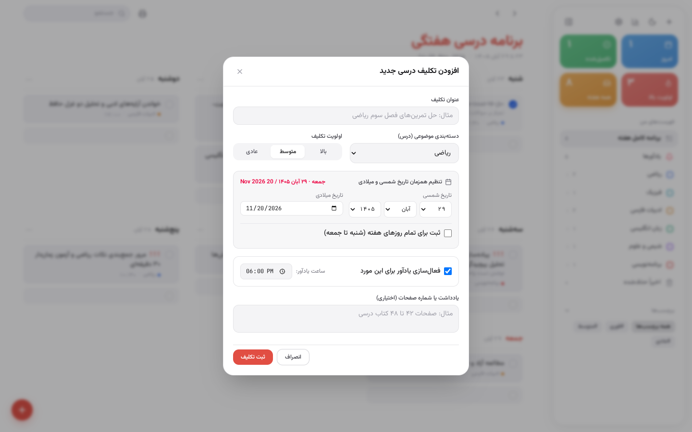
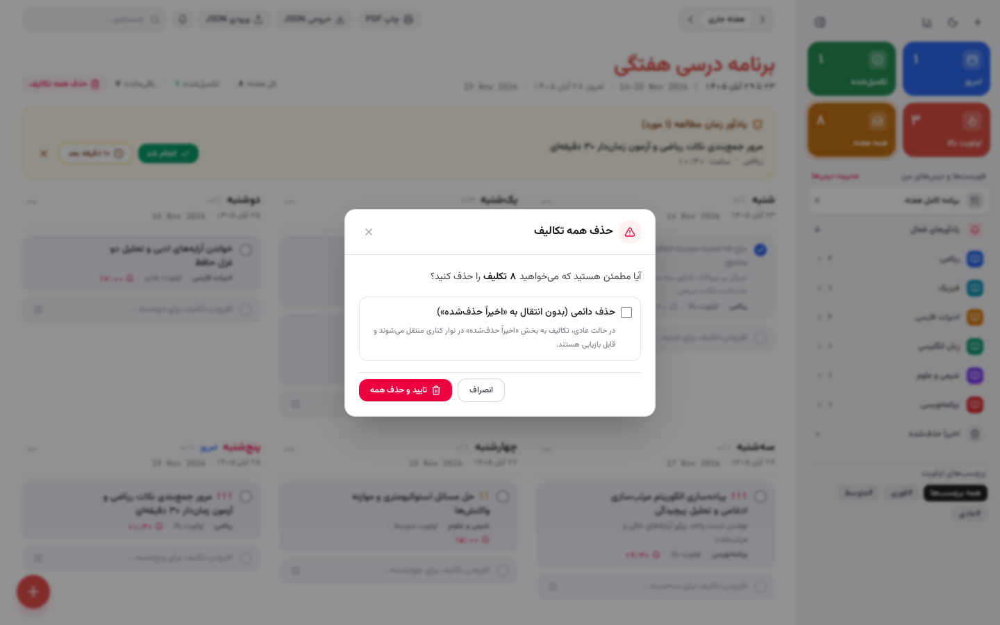
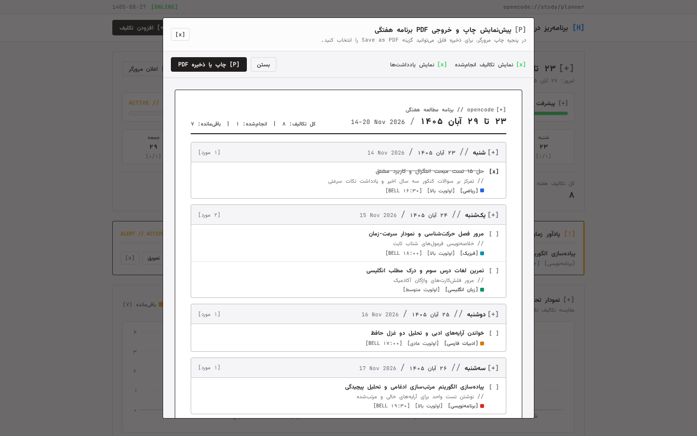
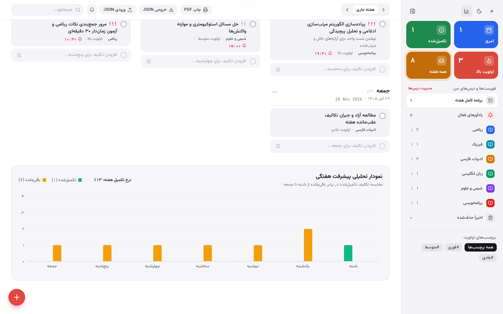

<a id="top"></a>

<div align="center">


# برنامه‌ریز درسی هفتگی | Weekly Study Planner

**مدیریت هوشمند و آفلاین تکالیف درسی هفتگی (شنبه تا جمعه) با رابط کاربری دوپانله مدرن، تقویم دوگانه شمسی و میلادی، ثبت تکلیف برای کل هفته، سطل بازیافت، خروجی مستقیم PDF و JSON، نمودار پیشرفت، PWA، نسخه دسکتاپ ۱۰۰٪ بومی با Rust (`iced`) و نسخه اندروید بومی Kotlin + XML**

**A fast, offline-first Weekly Study Task Manager (Saturday–Friday) featuring a modern split-pane Reminders UI, dual Jalali & Gregorian calendars, all-week task creation, Recently Deleted trash, direct A4 PDF & JSON exports, analytics charts, PWA support, a 100% Pure Rust desktop app (`iced`), and a standalone Kotlin + XML Android app.**

<br />

[-e11d48?style=for-the-badge)](#persian-docs)
[-059669?style=for-the-badge)](#english-docs)
[](https://github.com/arshiaghobadi0/Study-App-Manager/releases/latest)

<br />

[](https://react.dev/)
[-dea584?style=flat-square&logo=rust&logoColor=black)](desktop/)
[](android/)
[](https://tailwindcss.com/)
[](#)
[](#)
[](#license)

[ویژگی‌های جدید](#whats-new-fa) · [امکانات کامل](#features-fa) · [تصاویر نسخه جدید](#screenshots-fa) · [دانلود نسخه‌ها](#download-fa) · [اجرای محلی](#setup-fa)
<br />
[What's New](#whats-new-en) · [Features](#features-en) · [Screenshots](#screenshots-en) · [Downloads](#download-en) · [Development](#setup-en)

</div>

---

<a id="persian-docs"></a>

<div align="right">

> 🌐 **تغییر سریع زبان:** [🇬🇧 رفتن به مستندات انگلیسی (Switch to English)](#english-docs) · [📸 تصاویر نسخه جدید](#screenshots-fa) · [📥 دانلود](#download-fa)

</div>

## 🇮🇷 مستندات فارسی

**برنامه‌ریز درسی هفتگی** یک اپلیکیشن سبک، سریع و کاملاً آفلاین برای برنامه‌ریزی و پیگیری تکالیف درسی در طول هفته ایرانی (**شنبه تا جمعه**) است. تمام داده‌ها به‌صورت محلی روی دستگاه شما ذخیره می‌شوند و می‌توانید از آن هم به عنوان **وب‌اپ پیشرونده (PWA)** در مرورگر، هم به عنوان **اپلیکیشن دسکتاپ ۱۰۰٪ بومی با زبان Rust** (بدون هیچ کد جاوااسکریپت، تایپ‌اسکریپت یا WebView) روی ویندوز، macOS و لینوکس، و هم به عنوان **اپلیکیشن بومی Kotlin + XML** روی اندروید استفاده کنید.

<a id="whats-new-fa"></a>

### 🆕 ویژگی‌های جدید در نسخه بازطراحی‌شده

- **بازنویسی ۱۰۰٪ بومی نسخه‌های دسکتاپ با زبان Rust (`desktop/` — `iced 0.13`)**: انتقال کامل رابط کاربری، تقویم شمسی/میلادی، منطق تکالیف، نمودار بومی `Canvas`، یادآور و اعلان دسکتاپ، تنظیمات کامل، خروجی مستقیم PDF/چاپ A4 و پشتیبان‌گیری JSON به **Rust خالص** با فونت فارسی توکار `Vazirmatn` و شکل‌دهی کامل حروف فارسی (`cosmic-text` / `Shaping::Advanced`) — بدون نیاز به Node.js، جاوااسکریپت، تایپ‌اسکریپت یا WebKit2GTK/WebView2.
- **بازطراحی خلوت و مدرن رابط کاربری + پنجره تنظیمات کامل**: چیدمان دوپانله تمیز با نوار کناری جمع‌شونده شامل ۴ کاشی آماری رنگی، فهرست دروس با شمارنده زنده، برچسب‌های اولویت، پنجره تنظیمات اختصاصی (تم روشن/تاریک، ۶ رنگ اصلی، نمایش تقویم دوگانه/تکی، تراکم کارت‌ها، پیش‌فرض تکالیف و انیمیشن‌های نرم) و نوار بالای مینیمال.
- **ثبت تکلیف برای تمام روزهای هفته (شنبه تا جمعه)**: افزودن تیک **«ثبت برای تمام روزهای هفته (شنبه تا جمعه)»** در هر دو بخش **پنجره افزودن تکلیف** و **افزودن سریع درون‌خطی** برای ثبت هم‌زمان یک تکلیف تکراری در هر ۷ روز هفته انتخاب‌شده.
- **حذف همه تکالیف با پنجره تأیید امن (داخل تنظیمات)**: پاک‌سازی یکجای تکالیف با انتخاب دامنه (همه تکالیف یا فقط هفته جاری) و گزینه **حذف دائمی**؛ به‌صورت پیش‌فرض تکالیف به بخش **«اخیراً حذف‌شده»** منتقل می‌شوند تا در صورت نیاز قابل بازیابی باشند.
- **بخش «اخیراً حذف‌شده» (سطل بازیافت)**: نگهداری تکالیف حذف‌شده همراه با امکان بازیابی تکی، حذف دائمی یا خالی‌کردن کامل سطل بازیافت.
- **نسخه کاملاً بومی و مستقل اندروید با Kotlin + XML (Material 3)**: طراحی اختصاصی موبایل‌محور با تم سبز فیروزه‌ای و کهربایی، ناوبری ۴ تب در پایین صفحه، نمودارهای بومی Canvas، اعلان `AlarmManager` و تولید PDF بومی با `PdfDocument` در پوشه `Download/WeeklyStudyPlanner` (با سازگاری ۱۰۰٪ با فایل پشتیبان JSON نسخه‌های وب و دسکتاپ Rust).

<a id="features-fa"></a>

### ✨ امکانات کلیدی

- **برنامه‌ریزی هفتگی (شنبه تا جمعه)**: نمایش منظم ۷ روز هفته ایرانی با جابه‌جایی سریع بین «هفته قبل»، «هفته جاری» و «هفته بعد» و مشخص‌سازی خودکار روز «امروز».
- **تقویم دوگانه شمسی و میلادی**: نمایش هم‌زمان و دقیق تاریخ شمسی (با پشتیبانی کامل از سال‌های کبیسه در هر دو لایه TypeScript و Rust) و تاریخ میلادی در هدر، کارت‌های روزانه، پنجره ثبت تکلیف، نمودار و برگه چاپ.
- **افزودن سریع درون‌خطی و پنجره کامل تکلیف**: ثبت سریع تکلیف زیر هر روز همراه با منوی تنظیمات سریع (درس، اولویت، ساعت یادآور و تیک ثبت برای تمام هفته) یا ثبت با جزئیات کامل و یادداشت.
- **مدیریت دروس با رنگ اختصاصی**: ساخت، ویرایش و حذف درس‌ها با انتخاب رنگ اختصاصی (`SubjectModal`).
- **سیستم یادآور هوشمند**: تنظیم ساعت یادآور (`HH:mm`) برای هر تکلیف، بنر یادآورهای سررسیدشده در بالای صفحه، پخش صدای هشدار ملایم (Web Audio API)، تعویق ۱۰ دقیقه‌ای (Snooze)، تکمیل آنی و پشتیبانی از اعلان مرورگر (`Notification API`).
- **جستجو و فیلتر چندبعدی آنی**: جستجوی زنده در عنوان و یادداشت تکالیف همراه با فیلتر ترکیبی بر اساس کاشی‌های آماری، درس‌ها، یادآورهای فعال و برچسب‌های اولویت.
- **نمودار تحلیلی پیشرفت هفتگی**: نمودار میله‌ای تعاملی با **Recharts** برای مقایسه تکالیف تکمیل‌شده و باقی‌مانده در روزهای شنبه تا جمعه به همراه درصد پیشرفت هفته و Tooltip تاریخ دوگانه.
- **چاپ و خروجی مستقیم PDF (برگه A4)**: پیش‌نمایش استاندارد A4 با گزینه‌های نمایش/مخفی‌سازی تکالیف انجام‌شده و یادداشت‌ها، چاپ مستقیم و ذخیره فایل PDF.
- **پشتیبان‌گیری و بازیابی JSON**: خروجی گرفتن از کل تکالیف، درس‌ها و تم در قالب فایل `.json` تاریخ‌دار و بازیابی از طریق بارگذاری فایل یا چسباندن متن JSON به دو روش **جایگزینی کامل** یا **ادغام هوشمند**.
- **حالت تاریک (Dark Mode) و PWA آفلاین**: تم روشن و تاریک با ذخیره انتخاب کاربر، قابلیت نصب PWA روی موبایل و دسکتاپ، کش آفلاین Service Worker و نوار وضعیت آفلاین.

---

<a id="screenshots-fa"></a>

### 📸 تصاویر محیط نسخه جدید نرم‌افزار

| نمای دسکتاپ — حالت روشن (Light Mode) | نمای دسکتاپ — حالت تاریک (Dark Mode) |
| :---: | :---: |
|  |  |

| افزودن تکلیف با تیک «ثبت برای تمام روزهای هفته» | پنجره تأیید امن «حذف همه تکالیف» |
| :---: | :---: |
|  |  |

| پیش‌نمایش چاپ و خروجی مستقیم PDF (برگه A4) | نمودار تحلیلی پیشرفت هفتگی (Recharts) |
| :---: | :---: |
|  |  |

<div align="center">

#### نمای واکنش‌گرا در موبایل (Mobile View — 390×844)


</div>

---

<a id="download-fa"></a>

### 📥 دانلود نسخه‌های اجرایی

تمام نسخه‌های باینری به‌صورت خودکار توسط **GitHub Actions** از روی کد Rust/Tauri بیلد شده و همراه با فایل بررسی اصالت **SHA256** در صفحه **[Releases مخزن](https://github.com/arshiaghobadi0/Study-App-Manager/releases)** منتشر می‌شوند.

| پلتفرم | فرمت فایل | معماری | نوع بیلد | فایل تایید اصالت | لینک دانلود |
| :--- | :--- | :--- | :--- | :--- | :--- |
| **Windows** | نصاب ویندوز (`.exe` NSIS) | `x64` | Release | `*.exe.sha256` | [دانلود از Releases](https://github.com/arshiaghobadi0/Study-App-Manager/releases/latest) |
| **macOS (Apple Silicon)** | ایمیج نصبی (`.dmg`) | `arm64` (M1–M4) | Release | `*.dmg.sha256` | [دانلود از Releases](https://github.com/arshiaghobadi0/Study-App-Manager/releases/latest) |
| **macOS (Intel)** | ایمیج نصبی (`.dmg`) | `x64` | Release | `*.dmg.sha256` | [دانلود از Releases](https://github.com/arshiaghobadi0/Study-App-Manager/releases/latest) |
| **Linux (Debian / Ubuntu)** | بسته نصبی (`.deb`) | `amd64` / `x64` | Release | `*.deb.sha256` | [دانلود از Releases](https://github.com/arshiaghobadi0/Study-App-Manager/releases/latest) |
| **Linux (Arch / Manjaro)** | بسته نصبی (`.pkg.tar.zst`) | `x86_64` | Release | `*.pkg.tar.zst.sha256` | [دانلود از Releases](https://github.com/arshiaghobadi0/Study-App-Manager/releases/latest) |
| **Linux (توزیع‌های عمومی)** | اجرای مستقیم (`.AppImage`) | `x86_64` | Release | `*.AppImage.sha256` | [دانلود از Releases](https://github.com/arshiaghobadi0/Study-App-Manager/releases/latest) |
| **Android** | فایل نصبی بومی Kotlin + XML (`.apk`) | `Universal` (API 24–35) | Debug APK\* | `*.apk.sha256` | [دانلود از Releases](https://github.com/arshiaghobadi0/Study-App-Manager/releases/latest) |

> \* **نکته نسخه اندروید:** فایل APK فعلی به صورت Debug امضاشده با کلید موقت Gradle ساخته می‌شود تا بدون نیاز به تنظیم Keystore قابل نصب مستقیم باشد. پیش از ارتقا به نسخه جدید اندروید، یک پشتیبان JSON بگیرید (در پوشه `Download/WeeklyStudyPlanner` ذخیره می‌شود).

#### 🔐 بررسی صحت فایل با SHA256

- **لینوکس و macOS:**
  ```bash
  sha256sum -c <filename>.sha256
  # یا در macOS:
  shasum -a 256 -c <filename>.sha256
  ```
- **ویندوز (PowerShell):**
  ```powershell
  Get-FileHash .\<filename> -Algorithm SHA256
  Get-Content .\<filename>.sha256
  ```

#### 🐧 نکات نصب در لینوکس
- **دبیان / اوبونتو:** `sudo apt install ./weekly-study-planner_*.deb`
- **آرچ لینوکس / مانجارو:** `sudo pacman -U ./weekly-study-planner-1.0.0-1-x86_64.pkg.tar.zst` (یا ساخت مستقیم از `packaging/arch/PKGBUILD` با `makepkg -si`)
- **AppImage:** `chmod +x *.AppImage && ./Weekly*.AppImage`

---

<a id="setup-fa"></a>

### 🛠️ نصب و اجرای محلی

#### پیش‌نیازها
- **Rust + Cargo** (برای اجرا، تست و بیلد **نسخه دسکتاپ ۱۰۰٪ بومی Rust** بدون نیاز به Node.js)
- **Node.js 20+** (پیشنهادی: نسخه `22`) فقط برای نسخه وب/PWA

#### ۱. اجرای نسخه دسکتاپ ۱۰۰٪ بومی Rust (ویندوز / لینوکس / macOS)
```bash
git clone https://github.com/arshiaghobadi0/Study-App-Manager.git
cd Study-App-Manager

# اجرای تست‌های واحد Rust (تقویم شمسی، تکالیف، آمار، پشتیبان JSON و خروجی PDF)
cargo test --manifest-path desktop/Cargo.toml

# اجرای برنامه دسکتاپ بومی Rust
cargo run --release --manifest-path desktop/Cargo.toml
```

#### ۲. اجرای نسخه وب و PWA
```bash
npm install --legacy-peer-deps
npm run dev
# برنامه روی http://localhost:3000 اجرا می‌شود
```

#### ۳. تست‌های واحد نسخه وب
```bash
npx tsx --test src/utils/*.test.ts
npm run lint
```

#### ۴. ساخت بیلد تولیدی و انتشار خودکار در GitHub Releases
```bash
# بیلد نسخه دسکتاپ ۱۰۰٪ بومی Rust
cargo build --release --manifest-path desktop/Cargo.toml

# بیلد وب + PWA
npm run build
```
برای اجرای خودکار تمام بیلدها و انتشار در Releases گیت‌هاب، یک تگ نسخه ایجاد و پوش کنید (یا از تب **Actions** گزینه `workflow_dispatch` را اجرا نمایید):
```bash
git tag v1.1.0
git push origin v1.1.0
```

---

### 📦 نمونه فرمت پشتیبان JSON

```json
{
  "schemaVersion": 1,
  "settings": {
    "theme": "dark",
    "subjects": [
      { "id": "math", "name": "ریاضی", "color": "#2563eb" }
    ]
  },
  "tasks": [
    {
      "id": "task-1",
      "title": "حل تمرین فصل انتگرال",
      "notes": "مرور نکات کنکوری",
      "dateISO": "2026-11-16",
      "subjectId": "math",
      "priority": "high",
      "completed": false,
      "reminderEnabled": true,
      "reminderTime": "18:00"
    }
  ]
}
```

---

<a id="english-docs"></a>

> 🌐 **Language Shortcut:** [🇮🇷 رفتن به مستندات فارسی (Switch to Persian)](#persian-docs) · [📸 Screenshots](#screenshots-en) · [📥 Downloads](#download-en)

## 🇬🇧 English Documentation

**Weekly Study Planner** (`برنامه‌ریز درسی هفتگی`) is a streamlined, offline-first study task manager built around the Iranian 7-day week (**Saturday–Friday**). All tasks, subject categories, trash items, and settings persist locally on your device. It ships as three independent native targets: a **100% Pure Rust Desktop App (`desktop/` — `iced 0.13`, zero JS/TS/WebView)** for Windows, macOS, and Linux, a **Standalone Native Kotlin + XML Android App (`android/`)**, and an installable **Web/PWA edition (`src/`)**.

<a id="whats-new-en"></a>

### 🆕 What's New in the Redesigned Release

- **100% Pure Rust Desktop Rewrite (`desktop/` — `iced 0.13`)**: Complete migration of all desktop UI, Jalali/Gregorian calendar logic, task management, native Canvas analytics bar chart, reminders & desktop notifications, full Settings modal, A4 PDF/printable export, and `schemaVersion: 1` JSON backup into **pure Rust** with embedded `Vazirmatn` fonts and `cosmic-text` Persian RTL shaping—zero Node.js, zero TypeScript/JavaScript, and zero WebView/WebKit2GTK.
- **Minimalist Split-Pane UI & Full Settings**: Airy Apple Reminders-inspired design with collapsible sidebar, 2×2 color-coded quick-filter tiles, live subject counts, priority tags, and a grouped Settings modal (Light/Dark theme, 6 accent colors, dual/single calendar mode, density, defaults, smooth animations, and data management).
- **All-Week Task Registration (Saturday–Friday)**: Added a **"Register for all days of the week (Saturday–Friday)"** checkbox inside both task modal and inline per-day quick-add to schedule repeating tasks across all 7 days in one action.
- **Safe "Delete All Tasks" Confirmation (inside Settings)**: Bulk-delete modal supporting scope selection (all tasks vs. current week) and reversible soft-delete to Recently Deleted (with an optional permanent delete checkbox).
- **Standalone Native Android App (Kotlin + XML / Material 3)**: Purpose-built mobile-first Android edition under `android/` with a distinct Persian Teal & Warm Amber palette, 4-tab bottom navigation, native Canvas charts, `AlarmManager` notifications, and native `PdfDocument` exports—100% JSON backup compatible (`schemaVersion: 1`) with Desktop Rust & Web.

<a id="features-en"></a>

### ✨ Key Features

- **Weekly Schedule (Saturday to Friday)**: Structured 7-day layout with fast week navigation (`Previous`, `Current`, `Next`) and automatic highlighting for today's date.
- **Dual Jalali & Gregorian Calendar**: Simultaneous, accurate Persian (Jalali) and Gregorian dates across headers, day columns, modals, charts, and print sheets—implemented in both TypeScript (`src/utils/jalali.ts`) and Rust (`src-tauri/src/jalali.rs`) with leap-year handling.
- **Task Management & Inline Quick-Add**: Full CRUD with notes, subject categories, 3 priority tiers (`high`, `medium`, `low`), completion checkboxes, inline quick-add per day, and 7-day week expansion.
- **Custom Subject Categories**: Create, edit, and delete subjects with custom color swatches (`SubjectModal`).
- **Smart Study Reminders**: Per-task `HH:mm` reminders, an active due-reminders banner (`ReminderBanner`), Web Audio API chime (`sound.ts`), 10-minute snooze, instant completion/dismissal, and browser `Notification` API support.
- **Live Search & Multi-Facet Filtering**: Instant search across titles and notes combined with quick-filter tiles, subject lists, active reminders, and priority tags.
- **Weekly Progress Analytics Chart**: Interactive **Recharts** bar chart comparing completed vs. remaining tasks per day alongside weekly completion rate and dual-date tooltips.
- **A4 Print Preview & Direct PDF Export**: Print-ready `@media print` A4 sheet (`PrintScheduleModal` + `PrintableWeekSheet`) with toggles for completed tasks and notes plus direct PDF saving.
- **JSON Backup & Restore**: Export all tasks, subjects, and theme preference into a dated `.json` file; restore via file upload or pasted JSON with live validation and **Replace** or **Merge** modes.
- **Dark Mode & Offline PWA**: System-aware light/dark theme persisted to `localStorage`, Workbox offline caching, in-app install prompt (`PWAInstallButton`), and `OfflineIndicator`.

---

<a id="screenshots-en"></a>

### 📸 Screenshots

| Desktop — Light Mode | Desktop — Dark Mode |
| :---: | :---: |
|  |  |

| Add Task Modal (All Days of Week Toggle) | Safe "Delete All Tasks" Confirmation Modal |
| :---: | :---: |
|  |  |

| A4 Print & Direct PDF Export Preview | Weekly Progress Analytics (Recharts) |
| :---: | :---: |
|  |  |

<div align="center">

#### Responsive Mobile View (390×844)


</div>

---

<a id="download-en"></a>

### 📥 Downloads

Pre-built binaries for all major desktop and mobile platforms are compiled automatically via **GitHub Actions** and published with individual **SHA256** checksum files on **[GitHub Releases](https://github.com/arshiaghobadi0/Study-App-Manager/releases)**.

| Platform | Package Format | Architecture | Build Type | Checksum | Download |
| :--- | :--- | :--- | :--- | :--- | :--- |
| **Windows** | NSIS Installer (`.exe`) | `x64` | Release | `*.exe.sha256` | [Download from Releases](https://github.com/arshiaghobadi0/Study-App-Manager/releases/latest) |
| **macOS (Apple Silicon)** | Disk Image (`.dmg`) | `arm64` (M1–M4) | Release | `*.dmg.sha256` | [Download from Releases](https://github.com/arshiaghobadi0/Study-App-Manager/releases/latest) |
| **macOS (Intel)** | Disk Image (`.dmg`) | `x64` | Release | `*.dmg.sha256` | [Download from Releases](https://github.com/arshiaghobadi0/Study-App-Manager/releases/latest) |
| **Linux (Debian / Ubuntu)** | Debian Package (`.deb`) | `amd64` / `x64` | Release | `*.deb.sha256` | [Download from Releases](https://github.com/arshiaghobadi0/Study-App-Manager/releases/latest) |
| **Linux (Arch / Manjaro)** | Pacman Package (`.pkg.tar.zst`) | `x86_64` | Release | `*.pkg.tar.zst.sha256` | [Download from Releases](https://github.com/arshiaghobadi0/Study-App-Manager/releases/latest) |
| **Linux (Universal)** | Portable Binary (`.AppImage`) | `x86_64` | Release | `*.AppImage.sha256` | [Download from Releases](https://github.com/arshiaghobadi0/Study-App-Manager/releases/latest) |
| **Android** | Native Kotlin + XML APK (`.apk`) | `Universal` (API 24–35) | Debug APK\* | `*.apk.sha256` | [Download from Releases](https://github.com/arshiaghobadi0/Study-App-Manager/releases/latest) |

> \* **Android Build Note:** The Android `.apk` is currently built in `--debug` mode so it can be sideloaded directly without configuring a custom signing Keystore. Export a JSON backup (saved to `Download/WeeklyStudyPlanner`) before upgrading Android builds.

#### 🔐 Verify Downloads with SHA256

- **Linux / macOS:**
  ```bash
  sha256sum -c <filename>.sha256
  # On macOS:
  shasum -a 256 -c <filename>.sha256
  ```
- **Windows (PowerShell):**
  ```powershell
  Get-FileHash .\<filename> -Algorithm SHA256
  Get-Content .\<filename>.sha256
  ```

---

### 🏗️ Architecture & Tech Stack

- **Desktop Native App (Windows / macOS / Linux)**: **100% Pure Rust** (`desktop/`, Edition 2021) + `iced 0.13` (`cosmic-text` RTL Persian shaping, Canvas charts, embedded `Vazirmatn` fonts, `chrono`, `serde_json`, pure-Rust A4 PDF 1.4 writer) — zero JS/TS/Node/WebView
- **Android Native App**: Standalone **Kotlin + XML Views** (Material 3, ViewBinding, RecyclerView, Custom Canvas Charts, `PdfDocument`, `MediaStore.Downloads`, `AlarmManager`) under `android/`
- **Web & PWA Edition**: React 19, TypeScript, Vite 8, Tailwind CSS v4, Recharts, `jsPDF`, `vite-plugin-pwa` under `src/`
- **CI/CD**: Multi-platform GitHub Actions workflow (`.github/workflows/release.yml`)

```text
Study-App-Manager/
├── .github/workflows/
│   └── release.yml            # Pure Rust Desktop (Win/Linux/macOS) + Kotlin/XML Android CI
├── desktop/                   # 100% Pure Rust Native Desktop App (iced 0.13, zero JS/WebView)
│   ├── Cargo.toml
│   ├── assets/                # Embedded Vazirmatn Regular/Bold TTF + App PNG icon
│   └── src/
│       ├── main.rs            # Entry point, font & icon embedding, window setup
│       ├── app.rs             # Elm-architecture state, messages, update, cached view
│       ├── models.rs          # Domain models (schemaVersion 1 JSON compatible)
│       ├── jalali.rs          # Jalali/Gregorian math, leap years, Iranian week + tests
│       ├── tasks.rs           # Sorting, filtering, 7-day expansion, bulk delete, reminders + tests
│       ├── analytics.rs       # 7-day weekly progress series + tests
│       ├── backup.rs          # JSON export/import (Replace/Merge) + tests
│       ├── pdf_export.rs      # Pure-Rust A4 PDF 1.4 & RTL printable sheet writer + tests
│       ├── settings.rs        # Theme palettes, 6 accent presets, settings normalization + tests
│       ├── storage.rs         # Atomic local OS JSON persistence
│       ├── notifier.rs        # Native OS desktop notifications, chime, file opener
│       └── ui/                # Sidebar, Weekly Board, Canvas Analytics Chart, 6 Modals
├── android/                   # Standalone Native Kotlin + XML Material 3 Android App
├── packaging/
│   ├── arch/PKGBUILD          # Pure Rust Arch Linux package recipe
│   └── windows/installer.nsi  # Windows x64 NSIS installer script
├── docs/screenshots/          # UI screenshots
├── public/                    # PWA SVG/PNG/Maskable & Apple touch icons
└── src/                       # Web/PWA React + TypeScript application
```

---

<a id="setup-en"></a>

### 🛠️ Local Development

#### Prerequisites
- **Rust & Cargo** (for running, testing, and building the **100% Pure Rust desktop app**—no Node.js required)
- **Node.js 20+** (recommended `22`) only for the Web/PWA edition

#### 1. Run & Test the 100% Pure Rust Desktop App
```bash
git clone https://github.com/arshiaghobadi0/Study-App-Manager.git
cd Study-App-Manager

# Run all Pure Rust unit tests
cargo test --manifest-path desktop/Cargo.toml

# Launch the native Rust desktop app
cargo run --release --manifest-path desktop/Cargo.toml
```

#### 2. Run Web / PWA Dev Server
```bash
npm install --legacy-peer-deps
npm run dev
# Available at http://localhost:3000
```

#### 3. Web Tests & Type Checking
```bash
npx tsx --test src/utils/*.test.ts
npm run lint
```

#### 4. Production Build & Automated Release
```bash
# Build native Pure Rust desktop binary
cargo build --release --manifest-path desktop/Cargo.toml

# Build Web + PWA bundle
npm run build
```
To trigger an automated multi-platform build and publish all binaries + `.sha256` checksums to GitHub Releases:
```bash
git tag v1.1.0
git push origin v1.1.0
```

---

<a id="license"></a>

### 📄 License

Licensed under the **Apache License 2.0** — feel free to use, customize, and distribute.

<div align="center">

[⬆️ Back to Top / بازگشت به بالا](#top) · [🇮🇷 فارسی](#persian-docs) · [🇬🇧 English](#english-docs)

</div>
