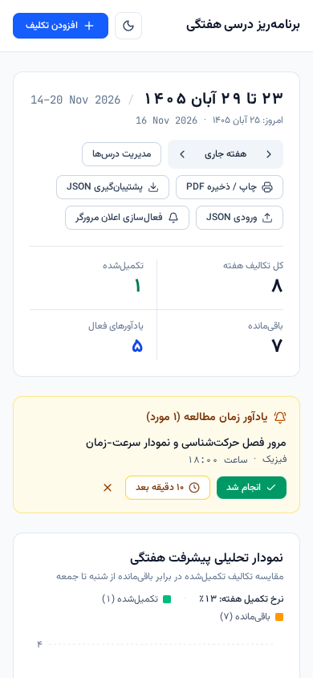

<a id="top"></a>

<div align="center">


# برنامه‌ریز درسی هفتگی | Weekly Study Planner

**مدیریت هوشمند تکالیف درسی هفتگی با تقویم دوگانه شمسی و میلادی، نمودار پیشرفت، خروجی PDF، پشتیبان JSON، PWA و بیلد بومی Rust (Tauri v2)**

**A fast, offline-first Weekly Study Task Manager featuring dual Jalali & Gregorian calendars, Recharts analytics, A4 PDF print, JSON backup/restore, PWA support, and native Rust/Tauri v2 builds.**

<br />

<!-- Language Switcher Shortcuts in Header -->
[-2563eb?style=for-the-badge)](#persian-docs)
[-059669?style=for-the-badge)](#english-docs)
[](https://github.com/arshiaghobadi0/Study-App-Manager/releases/latest)

<br />

[](https://react.dev/)
[](https://www.typescriptlang.org/)
[](https://v2.tauri.app/)
[](https://tailwindcss.com/)
[](#)
[](#license)

[امکانات](#features-fa) · [تصاویر نرم‌افزار](#screenshots-fa) · [دانلود](#download-fa) · [اجرای محلی](#setup-fa)
<br />
[Features](#features-en) · [Screenshots](#screenshots-en) · [Download](#download-en) · [Development](#setup-en)

</div>

---

<a id="persian-docs"></a>

<div align="right">

> 🌐 **تغییر سریع زبان:** [🇺🇸 رفتن به مستندات انگلیسی (Switch to English)](#english-docs) · [📥 بخش دانلود](#download-fa)

</div>

## 🇮🇷 مستندات فارسی

**برنامه‌ریز درسی هفتگی** یک اپلیکیشن سبک، سریع و کاملاً بهینه برای برنامه‌ریزی و پیگیری تکالیف درسی در طول هفته (شنبه تا جمعه) است. تمام داده‌ها به‌صورت محلی روی دستگاه ذخیره می‌شوند و برنامه هم به شکل **وب‌اپ پیشرونده (PWA)** با قابلیت کار آفلاین و هم به عنوان **اپلیکیشن بومی مبتنی بر Rust (Tauri v2)** روی ویندوز، مک، لینوکس و اندروید قابل استفاده است.

<a id="features-fa"></a>

### ✨ امکانات کلیدی

- **برنامه‌ریزی هفتگی (شنبه تا جمعه)**: دسته‌بندی تکالیف بر اساس ۷ روز هفته ایرانی همراه با دکمه‌های جابه‌جایی سریع بین «هفته قبل»، «هفته جاری» و «هفته بعد» و نمایش برچسب «امروز».
- **تقویم دوگانه شمسی و میلادی**: نمایش دقیق و هم‌زمان تاریخ شمسی (با محاسبه دقیق سال‌های کبیسه در هر دو لایه TypeScript و Rust) در کنار تاریخ میلادی برای بازه هفته و تک‌تک روزها.
- **مدیریت تکالیف و افزودن سریع**: ایجاد، ویرایش و حذف تکالیف با عنوان، یادداشت، انتخاب درس، اولویت سه‌سطحی (**بالا**، **متوسط**، **عادی**) و افزودن سریع درون‌خطی (`افزودن سریع`) برای هر روز.
- **دسته‌بندی موضوعی دروس**: امکان ساخت، ویرایش و حذف درس‌ها به همراه انتخاب رنگ اختصاصی (`SubjectModal`).
- **سیستم یادآور هوشمند**: تنظیم ساعت یادآور (`HH:mm`) برای هر تکلیف، بنر اعلان‌های سررسیدشده در بالای صفحه، پخش صدای ملایم هشدار (Web Audio API)، تعویق ۱۰ دقیقه‌ای (Snooze) و پشتیبانی از اعلان مرورگر (`Notification API`).
- **فیلتر و جستجوی آنی**: جستجو در عنوان و یادداشت تکالیف و فیلتر هم‌زمان بر اساس درس، سطح اولویت و وضعیت (همه / باقی‌مانده / انجام‌شده).
- **نمودار تحلیلی پیشرفت هفتگی**: رسم نمودار میله‌ای تعاملی با **Recharts** برای مقایسه تکالیف تکمیل‌شده در برابر باقی‌مانده به تفکیک روزهای شنبه تا جمعه همراه با نرخ پیشرفت هفته و Tooltip دوگانه تاریخ.
- **چاپ و خروجی PDF استاندارد**: پیش‌نمایش صفحه چاپ A4 با چیدمان راست‌به‌چپ (`@media print`)، گزینه‌های نمایش/مخفی‌سازی تکالیف انجام‌شده و یادداشت‌ها و ذخیره مستقیم به صورت PDF.
- **حالت تاریک (Dark Mode)**: دکمه تغییر تم در هدر با ذخیره‌سازی انتخاب کاربر و هماهنگی خودکار با تنظیمات سیستم‌عامل.
- **پشتیبان‌گیری و بازیابی JSON**:
  - خروجی گرفتن از کل تکالیف، درس‌ها و تم در قالب فایل `.json` تاریخ‌دار (در نسخه دسکتاپ/اندروید Tauri مستقیماً توسط دستور بومی Rust در پوشه Downloads ذخیره می‌شود).
  - دریافت ورودی JSON از طریق انتخاب فایل یا چسباندن مستقیم متن، اعتبارسنجی لحظه‌ای ساختار و اعمال به دو روش **جایگزینی کامل** یا **ادغام هوشمند**.
- **قابلیت PWA و کارکرد آفلاین**: قابل نصب روی موبایل و دسکتاپ از طریق مرورگر، همراه با کش آفلاین Service Worker و نوار اطلاع‌رسانی حالت آفلاین.

---

<a id="screenshots-fa"></a>

### 📸 تصاویر محیط نرم‌افزار

| نمای دسکتاپ — حالت روشن (Light Mode) | نمای دسکتاپ — حالت تاریک (Dark Mode) |
| :---: | :---: |
|  |  |

| پیش‌نمایش چاپ و خروجی PDF (برگه A4) | نمای واکنش‌گرا در موبایل (Mobile View) |
| :---: | :---: |
|  |  |

---

<a id="download-fa"></a>

### 📥 دانلود نسخه‌های اجرایی

تمام نسخه‌های باینری به‌صورت خودکار توسط **GitHub Actions** از روی کد Rust/Tauri بیلد شده و همراه با فایل بررسی اصالت **SHA256** در صفحه **[Releases مخزن](https://github.com/arshiaghobadi0/Study-App-Manager/releases)** منتشر می‌شوند.

| پلتفرم | فرمت فایل | معماری | فایل تایید اصالت | لینک دانلود |
| :--- | :--- | :--- | :--- | :--- |
| **Windows** | نصاب ویندوز (`.exe` NSIS) | `x64` | `*.exe.sha256` | [دانلود از Releases](https://github.com/arshiaghobadi0/Study-App-Manager/releases/latest) |
| **macOS (Apple Silicon)** | ایمیج نصبی (`.dmg`) | `arm64` (M1–M4) | `*.dmg.sha256` | [دانلود از Releases](https://github.com/arshiaghobadi0/Study-App-Manager/releases/latest) |
| **macOS (Intel)** | ایمیج نصبی (`.dmg`) | `x64` | `*.dmg.sha256` | [دانلود از Releases](https://github.com/arshiaghobadi0/Study-App-Manager/releases/latest) |
| **Linux (Debian / Ubuntu)** | بسته نصبی (`.deb`) | `amd64` / `x64` | `*.deb.sha256` | [دانلود از Releases](https://github.com/arshiaghobadi0/Study-App-Manager/releases/latest) |
| **Linux (Arch / Manjaro)** | بسته نصبی (`.pkg.tar.zst`) | `x86_64` | `*.pkg.tar.zst.sha256` | [دانلود از Releases](https://github.com/arshiaghobadi0/Study-App-Manager/releases/latest) |
| **Linux (توزیع‌های عمومی)** | اجرای مستقیم (`.AppImage`) | `x86_64` | `*.AppImage.sha256` | [دانلود از Releases](https://github.com/arshiaghobadi0/Study-App-Manager/releases/latest) |
| **Android** | فایل نصبی امضاشده انتشار (`.apk`) | `arm64 + armv7` | `*.apk.sha256` | [دانلود از Releases](https://github.com/arshiaghobadi0/Study-App-Manager/releases/latest) |

#### 🔐 بررسی صحت فایل با SHA256
پس از دانلود فایل برنامه و فایل `.sha256` هم‌نام آن از صفحه Releases:

- **لینوکس و macOS:**
  ```bash
  sha256sum -c <filename>.sha256
  # یا در macOS:
  shasum -a 256 -c <filename>.sha256
  ```
- **ویندوز (PowerShell):**
  ```powershell
  Get-FileHash .\<filename> -Algorithm SHA256
  Get-Content .\<filename>.sha256
  ```

#### 🐧 نکات نصب در لینوکس
- **دبیان / اوبونتو:** `sudo apt install ./weekly-study-planner_*.deb`
- **آرچ لینوکس / مانجارو:** `sudo pacman -U ./weekly-study-planner-1.0.0-1-x86_64.pkg.tar.zst` (یا ساخت مستقیم از `packaging/arch/PKGBUILD` با `makepkg -si`)
- **AppImage:** `chmod +x *.AppImage && ./Weekly*.AppImage`

---

<a id="setup-fa"></a>

### 🛠️ نصب و اجرای محلی

#### پیش‌نیازها
- **Node.js 20+** (پیشنهادی: نسخه `22`) و `npm`
- **Rust + Cargo** (فقط برای بیلد دسکتاپ/موبایل با Tauri v2)

#### ۱. کلون و نصب وابستگی‌ها
```bash
git clone https://github.com/arshiaghobadi0/Study-App-Manager.git
cd Study-App-Manager
npm install --legacy-peer-deps
```

#### ۲. اجرای نسخه وب و PWA
```bash
npm run dev
# برنامه روی http://localhost:3000 اجرا می‌شود
```

#### ۳. اجرای نسخه بومی Rust (Tauri v2)
```bash
npm install --no-save --legacy-peer-deps @tauri-apps/cli@^2
npx tauri dev
```

#### ۴. اجرای تست‌ها و بررسی تایپ‌ها
```bash
# تست‌های واحد فرانت‌اند (۲۲ تست)
npx tsx --test src/utils/*.test.ts

# بررسی تایپ‌های TypeScript
npm run lint

# تست‌های واحد Rust (تبدیل تقویم شمسی/میلادی)
cargo test --manifest-path src-tauri/Cargo.toml
```

#### ۵. ساخت بیلد تولیدی و انتشار خودکار در GitHub Releases
```bash
# بیلد وب + PWA
npm run build

# بیلد دسکتاپ محلی با Rust/Tauri
npx tauri build
```
برای اجرای خودکار تمام بیلدها و انتشار در Releases گیت‌هاب، یک تگ نسخه ایجاد و پوش کنید:
```bash
git tag v1.0.0
git push origin v1.0.0
```

---

### 📦 نمونه فرمت ورودی / خروجی JSON

علاوه بر فایل کامل پشتیبان برنامه، امکان وارد کردن یک آرایه ساده از تکالیف نیز پشتیبانی می‌شود:

```json
{
  "schemaVersion": 1,
  "settings": {
    "theme": "dark",
    "subjects": [
      { "id": "math", "name": "ریاضی", "color": "#2563eb" }
    ]
  },
  "tasks": [
    {
      "id": "task-1",
      "title": "حل تمرین فصل انتگرال",
      "notes": "مرور نکات کنکوری",
      "dateISO": "2026-11-16",
      "subjectId": "math",
      "priority": "high",
      "completed": false,
      "reminderEnabled": true,
      "reminderTime": "18:00"
    }
  ]
}
```

---

<a id="english-docs"></a>

> 🌐 **Language Shortcut:** [🇮🇷 رفتن به مستندات فارسی (Switch to Persian)](#persian-docs) · [📥 Download Binaries](#download-en)

## 🇬🇧 English Documentation

**Weekly Study Planner** (`برنامه‌ریز درسی هفتگی`) is a streamlined, offline-first study task management application built around the Iranian 7-day week (**Saturday–Friday**). All tasks, subject categories, and theme settings persist locally on your device, and the app runs seamlessly both as an installable **Progressive Web App (PWA)** and as a native **Rust + Tauri v2** application across Windows, macOS, Linux, and Android.

<a id="features-en"></a>

### ✨ Key Features

- **Weekly Schedule (Saturday to Friday)**: Structured 7-day layout with quick week navigation (`Previous`, `Current`, `Next`) and automatic highlighting for today's date.
- **Dual Jalali & Gregorian Calendar**: Accurate, simultaneous Persian (Jalali) and Gregorian dates across week headers, day sections, and charts—implemented in both TypeScript (`src/utils/jalali.ts`) and Rust (`src-tauri/src/jalali.rs`) with leap-year handling.
- **Task Management & Inline Quick-Add**: Create, edit, and delete study tasks with optional notes, subject tag, 3 priority tiers (`high`, `medium`, `low`), completion toggles, and fast inline task creation per day.
- **Custom Subject Categories**: Full CRUD management for academic subjects with custom color swatches (`SubjectModal`).
- **Smart Study Reminders**: Per-task `HH:mm` reminders, an active due-reminders banner (`ReminderBanner`), Web Audio API chime (`sound.ts`), 10-minute snooze, dismiss/complete quick actions, and browser `Notification` API support.
- **Live Filtering & Search**: Instant filtering across search text (title & notes), subject category, priority level, and completion status.
- **Weekly Progress Analytics Chart**: Interactive **Recharts** bar chart comparing completed vs. remaining tasks per day alongside weekly completion percentage and dual-date tooltips.
- **A4 Print & PDF Export**: Dedicated `@media print` A4 sheet preview (`PrintScheduleModal` + `PrintableWeekSheet`) with toggles for completed tasks and notes, ready to save as PDF.
- **Dark Mode**: Header theme toggle saved to `localStorage` (`study_planner_theme_v1`), respecting system `prefers-color-scheme` with flash-free startup.
- **JSON Backup & Restore**:
  - Export all tasks, subjects, and theme preference into a dated `.json` file (automatically saved to Downloads natively via Rust `save_json_backup` when running in Tauri, or downloaded via browser Blob).
  - Restore from `.json` file upload or pasted JSON text with live validation and **Replace** or **Merge** import modes.
- **PWA & Offline Support**: Installable web app with Workbox asset caching, an in-app install prompt (`PWAInstallButton` supporting Chromium `beforeinstallprompt` & iOS Safari instructions), and an `OfflineIndicator` banner.

---

<a id="screenshots-en"></a>

### 📸 Screenshots

| Desktop — Light Mode | Desktop — Dark Mode |
| :---: | :---: |
|  |  |

| A4 Print / PDF Export Preview | Responsive Mobile View |
| :---: | :---: |
|  |  |

---

<a id="download-en"></a>

### 📥 Download

Pre-built binaries for all major desktop and mobile platforms are compiled automatically via **GitHub Actions** and published with individual **SHA256** checksum files on the **[GitHub Releases](https://github.com/arshiaghobadi0/Study-App-Manager/releases)** page.

| Platform | Package Format | Architecture | Checksum | Download |
| :--- | :--- | :--- | :--- | :--- |
| **Windows** | NSIS Installer (`.exe`) | `x64` | `*.exe.sha256` | [Download from Releases](https://github.com/arshiaghobadi0/Study-App-Manager/releases/latest) |
| **macOS (Apple Silicon)** | Disk Image (`.dmg`) | `arm64` (M1–M4) | `*.dmg.sha256` | [Download from Releases](https://github.com/arshiaghobadi0/Study-App-Manager/releases/latest) |
| **macOS (Intel)** | Disk Image (`.dmg`) | `x64` | `*.dmg.sha256` | [Download from Releases](https://github.com/arshiaghobadi0/Study-App-Manager/releases/latest) |
| **Linux (Debian / Ubuntu)** | Debian Package (`.deb`) | `amd64` / `x64` | `*.deb.sha256` | [Download from Releases](https://github.com/arshiaghobadi0/Study-App-Manager/releases/latest) |
| **Linux (Arch / Manjaro)** | Pacman Package (`.pkg.tar.zst`) | `x86_64` | `*.pkg.tar.zst.sha256` | [Download from Releases](https://github.com/arshiaghobadi0/Study-App-Manager/releases/latest) |
| **Linux (Universal)** | Portable Binary (`.AppImage`) | `x86_64` | `*.AppImage.sha256` | [Download from Releases](https://github.com/arshiaghobadi0/Study-App-Manager/releases/latest) |
| **Android** | Signed Release APK (`.apk`) | `arm64 + armv7` | `*.apk.sha256` | [Download from Releases](https://github.com/arshiaghobadi0/Study-App-Manager/releases/latest) |

#### 🔐 Verify Downloads with SHA256
Download both the installer and its matching `.sha256` file from Releases, then run:

- **Linux / macOS:**
  ```bash
  sha256sum -c <filename>.sha256
  # On macOS:
  shasum -a 256 -c <filename>.sha256
  ```
- **Windows (PowerShell):**
  ```powershell
  Get-FileHash .\<filename> -Algorithm SHA256
  Get-Content .\<filename>.sha256
  ```

---

### 🏗️ Architecture & Tech Stack

- **Frontend**: React 19, TypeScript, Vite 8, Tailwind CSS v4, Recharts, Lucide React, `vite-plugin-pwa`
- **Native Core (Desktop & Android)**: Rust (Edition 2021) + Tauri v2 (`src-tauri/`)
- **CI/CD**: Multi-platform GitHub Actions workflow (`.github/workflows/release.yml`)

```text
Study-App-Manager/
├── .github/workflows/
│   └── release.yml            # Multi-OS Rust/Tauri CI + SHA256 + GitHub Releases
├── docs/screenshots/          # Application UI screenshots
├── packaging/arch/
│   └── PKGBUILD               # Arch Linux build recipe for Rust/Tauri binary
├── public/                    # PWA SVG/PNG/Maskable & Apple touch icons
├── src/
│   ├── components/            # Modals, Day cards, Recharts chart, PDF sheet, PWA UI
│   ├── hooks/                 # usePWAInstall, useOnlineStatus
│   ├── types/                 # TypeScript interfaces (StudyTask, SubjectCategory)
│   ├── utils/                 # Jalali math, filters, JSON backup/import, Tauri bridge & unit tests
│   ├── App.tsx                # Main application state & weekly planner view
│   └── main.tsx               # App bootstrap & Service Worker registration
└── src-tauri/
    ├── capabilities/          # Tauri v2 permission capabilities
    ├── src/
    │   ├── jalali.rs          # Rust Jalali/Gregorian converter + unit tests
    │   ├── lib.rs             # Tauri commands & desktop/mobile entrypoint
    │   └── main.rs            # Desktop binary entrypoint
    ├── Cargo.toml
    └── tauri.conf.json
```

---

<a id="setup-en"></a>

### 🛠️ Local Development

#### Prerequisites
- **Node.js 20+** (recommended `22`) and `npm`
- **Rust & Cargo** (only required for native Tauri desktop/Android builds; not needed for Web/PWA dev)

#### 1. Clone & Install
```bash
git clone https://github.com/arshiaghobadi0/Study-App-Manager.git
cd Study-App-Manager
npm install --legacy-peer-deps
```

#### 2. Run Web / PWA Dev Server
```bash
npm run dev
# Available at http://localhost:3000
```

#### 3. Run Native Rust / Tauri Desktop App
```bash
npm install --no-save --legacy-peer-deps @tauri-apps/cli@^2
npx tauri dev
```

#### 4. Tests & Type Checking
```bash
# Run all 22 TypeScript utility unit tests
npx tsx --test src/utils/*.test.ts

# Run TypeScript type check
npm run lint

# Run Rust unit tests (Jalali calendar module)
cargo test --manifest-path src-tauri/Cargo.toml
```

#### 5. Production Build & Automated Release
```bash
# Build Web + PWA bundle
npm run build

# Build native Tauri bundle locally
npx tauri build
```
To trigger an automated multi-platform build and publish all binaries + `.sha256` checksums to GitHub Releases:
```bash
git tag v1.0.0
git push origin v1.0.0
```

---

<a id="license"></a>

### 📄 License

Licensed under the **Apache License 2.0** — feel free to use, customize, and distribute.

<div align="center">

[⬆️ Back to Top / بازگشت به بالا](#top) · [🇮🇷 فارسی](#persian-docs) · [🇬🇧 English](#english-docs)

</div>
