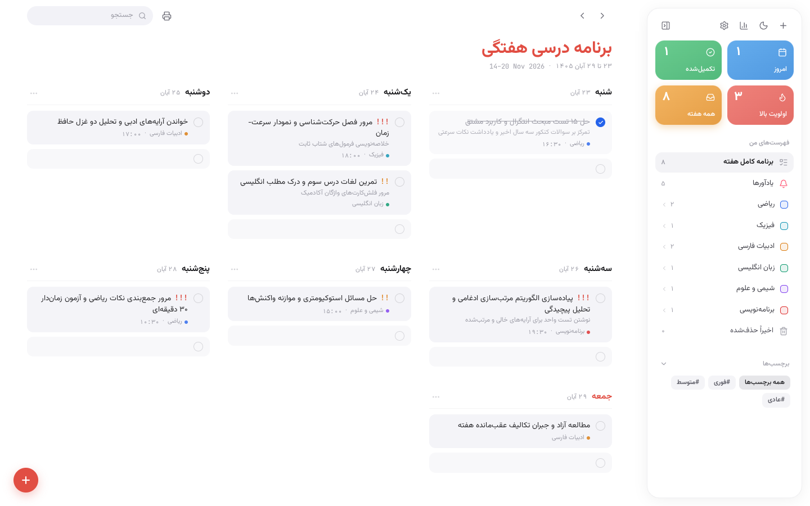
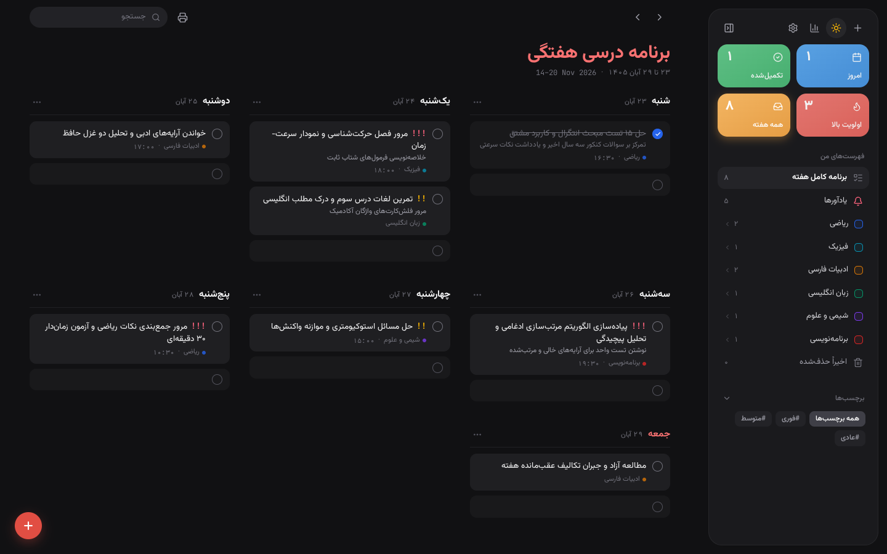
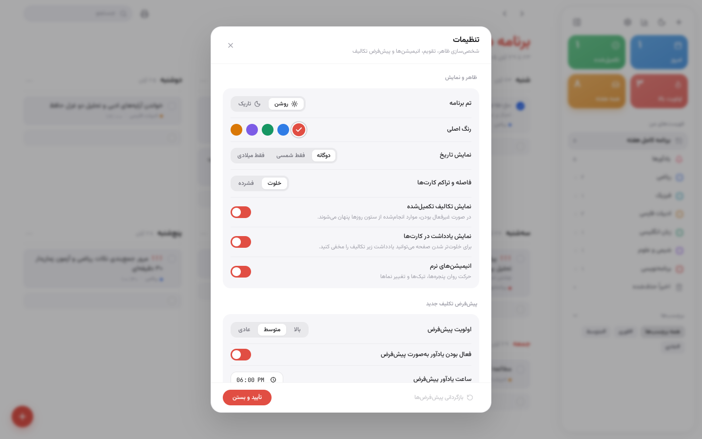

<div dir="rtl" align="center">

# برنامه‌ریز درسی هفتگی (Weekly Study Planner)

**اپلیکیشن چندپلتفرمی، آفلاین‌محور و مینیمال برای مدیریت تکالیف و برنامه مطالعه هفتگی با تقویم دوگانه شمسی و میلادی**


-DEA584?style=flat-square&logo=rust&logoColor=black)


</div>

---

<div dir="rtl">

## معرفی پروژه

**برنامه‌ریز درسی هفتگی** برای برنامه‌ریزی منظم مطالعه از **شنبه تا جمعه** طراحی شده است و با تمرکز بر **خلوتی رابط کاربری**، **سرعت بالا** و **کارکرد کاملاً آفلاین**، روی همه دستگاه‌ها به‌صورت بومی اجرا می‌شود:

- **نسخه وب و PWA:** ساخته‌شده با React 19، TypeScript، Tailwind CSS v4 و قابلیت نصب آفلاین (Service Worker).
- **نسخه دسکتاپ (ویندوز، لینوکس و مک):** بازنویسی‌شده به‌صورت **۱۰۰٪ خالص با زبان Rust** و فریم‌ورک گرافیکی `iced 0.13.1` — بدون Node.js، بدون JavaScript و بدون WebView، همراه با فونت فارسی توکار `Vazirmatn`.
- **نسخه اندروید:** بازنویسی‌شده به‌صورت **کاملاً بومی با Kotlin و XML (Material 3 + ViewBinding)** با ساختار ناوبری پایین ۴تب، یادآورهای دقیق `AlarmManager` و ذخیره مستقیم PDF/JSON در پوشه `Downloads`.

---

## پیش‌نمایش برنامه

### نمای اصلی (حالت روشن و تاریک)

| حالت روشن (رابط کاربری خلوت) | حالت تاریک |
| :---: | :---: |
|  |  |

### تنظیمات، آمار پیشرفت، ثبت تکلیف و خروجی PDF

| تنظیمات و شخصی‌سازی | نمودار تحلیلی پیشرفت هفتگی |
| :---: | :---: |
|  |  |

| افزودن تکلیف با تقویم دوگانه و تکرار هفتگی | پیش‌نمایش چاپ A4 و ذخیره PDF |
| :---: | :---: |
|  |  |

### نمای موبایل (واکنش‌گرا)

<p align="center">
  
</p>

---

## امکانات و ویژگی‌ها

### مدیریت تکالیف و تقویم دوگانه
- **تقویم شمسی و میلادی همزمان:** نمایش تاریخ هفته از **شنبه تا جمعه** و انتخاب همگام تاریخ شمسی و میلادی هنگام ثبت یا ویرایش تکلیف.
- **ثبت سریع و تکرار در کل هفته:** امکان افزودن سریع تکلیف در ستون هر روز، یا ثبت جزئیات کامل با گزینه **«ثبت برای تمام روزهای هفته (شنبه تا جمعه)»**.
- **دسته‌بندی موضوعی (درس‌ها):** تعریف، رنگ‌بندی و مدیریت درس‌های دلخواه (ریاضی، فیزیک، ادبیات فارسی، زبان انگلیسی، شیمی و علوم، برنامه‌نویسی و…).
- **فیلترهای هوشمند و جستجو:** کاشی‌های سریع نوار کناری (**امروز**، **تکمیل‌شده**، **اولویت بالا**، **همه هفته**)، فیلتر بر اساس درس، برچسب‌های اولویت (`#فوری`، `#متوسط`، `#عادی`)، فیلتر یادآورها و جستجوی آنی.

### تنظیمات جامع و تجربه کاربری روان
- **تم و رنگ اصلی:** انتخاب بین حالت **روشن / تاریک** و پالت‌های رنگی (مرجانی، آبی، زمردی، بنفش، کهربایی — و اسلیت در نسخه دسکتاپ).
- **کنترل نمایش:** انتخاب فرمت تاریخ (**دوگانه**، **فقط شمسی** یا **فقط میلادی**)، تنظیم تراکم کارت‌ها (**خلوت** یا **فشرده**)، نمایش یا مخفی‌سازی تکالیف تکمیل‌شده و یادداشت‌ها.
- **انیمیشن‌های نرم:** گذارهای روان برای مودال‌ها، تغییر نماها، کشوی موبایل و تیک تکالیف با قابلیت خاموش کردن از تنظیمات.
- **پیش‌فرض تکلیف جدید:** تعیین اولویت پیش‌فرض، وضعیت پیش‌فرض یادآور و ساعت یادآور پیش‌فرض.

### یادآورها، آمار و مدیریت داده‌ها
- **یادآور هوشمند مطالعه:** بنر یادآور داخل برنامه با امکان تکمیل سریع یا به تعویق انداختن (Snooze)، پخش صدای زنگ ملایم (همراه با دکمه تست صدا) و اعلان بومی سیستم‌عامل.
- **نمودار تحلیلی پیشرفت هفتگی:** نمایش ستونی تکالیف تکمیل‌شده در برابر باقی‌مانده در طول ۷ روز هفته همراه با درصد پیشرفت کل هفته.
- **سطل بازیافت (اخیراً حذف‌شده) و حذف دسته‌جمعی:** بازیابی تکالیف حذف‌شده یا حذف دائمی آن‌ها، و امکان حذف کل تکالیف یا تکالیف هفته جاری از بخش تنظیمات.
- **چاپ A4 و خروجی PDF:** پیش‌نمایش زنده برگه چاپ هفتگی با قابلیت حذف/نمایش تکالیف انجام‌شده و یادداشت‌ها و ذخیره مستقیم فایل PDF.
- **پشتیبان‌گیری و بازیابی JSON:** خروجی و ورودی فایل JSON شامل تکالیف، درس‌ها و تم با پشتیبانی از دو حالت **ادغام (Merge)** و **جایگزینی کامل (Replace)**.

---

## معماری پلتفرم‌ها و ترکیب زبان‌ها

هر پلتفرم با فناوری بومی و مستقل خود پیاده‌سازی شده است تا حداکثر سرعت، سبک‌بودن و هماهنگی با سیستم‌عامل حفظ شود:

| پلتفرم | فناوری و کتابخانه‌ها | ذخیره‌سازی آفلاین | اعلان و خروجی فایل |
| :--- | :--- | :--- | :--- |
| **وب و PWA** (`src/`) | React 19، TypeScript، Vite 8، Tailwind CSS v4، Recharts، jsPDF، `vite-plugin-pwa` | `localStorage` + Service Worker | Notification API + دانلود مستقیم PDF/JSON |
| **دسکتاپ** (`desktop/`) | **100% Pure Rust**، `iced 0.13.1`، `serde`، `chrono`، `dirs`، فونت توکار `Vazirmatn` | فایل اتمیک `state.json` در پوشه داده کاربر | `notify-send` / `osascript` / PowerShell + تولیدگر بومی PDF 1.4 و برگه چاپ HTML |
| **اندروید** (`android/`) | **Native Kotlin + XML**، Material 3، ViewBinding، ViewModel/LiveData، RecyclerView | ذخیره‌سازی محلی اندروید | `AlarmManager` + ذخیره مستقیم PDF و JSON در `Downloads` |

### سهم زبان‌های پروژه (بر اساس حجم سورس)

پروژه از **۸ زبان** تشکیل شده که ۴ زبان اصلی (**۹۸.۷٪** کد) را می‌سازند و **۰٪ JavaScript** در سورس اصلی وجود دارد:

- **TypeScript:** `36.7%` (نسخه وب و PWA)
- **Rust:** `29.9%` (نسخه دسکتاپ ویندوز، لینوکس و مک)
- **Kotlin:** `18.7%` (منطق و UI نسخه اندروید)
- **XML:** `13.4%` (لایوت‌ها، تم‌ها و منابع اندروید)
- **سایر (`1.3%`):** CSS (`0.7%`)، HTML (`0.3%`)، NSIS (`0.3%`) و Shell (`0.1%`)

---

## ساختار پوشه‌ها

```text
.
├── src/                        # نسخه وب و PWA (React 19 + TypeScript)
│   ├── App.tsx                 # شل اصلی برنامه، وضعیت‌ها و هماهنگی نماها
│   ├── components/             # کامپوننت‌های رابط کاربری (Sidebar, Settings, Modals, Chart, Print)
│   ├── hooks/                  # هوک‌های PWA و وضعیت آنلاین/آفلاین
│   ├── types/                  # تعریف مدل‌های داده TypeScript
│   └── utils/                  # تقویم جلالی، پشتیبان JSON، PDF، تنظیمات، آمار و تست‌های واحد
├── desktop/                    # نسخه بومی دسکتاپ (۱۰۰٪ Pure Rust / iced)
│   ├── Cargo.toml              # تنظیمات و وابستگی‌های Rust
│   ├── assets/                 # فونت فارسی Vazirmatn و آیکون برنامه
│   └── src/                    # منطق، تقویم، PDF، اعلان سیستمی و ماژول‌های UI
├── android/                    # نسخه بومی اندروید (Kotlin + XML / Material 3)
│   └── app/src/main/           # اکتیویتی، فرگمنت‌ها، ViewModel، AlarmManager، PDF و لایوت‌های XML
├── packaging/                  # اسکریپت‌های بسته‌بندی دسکتاپ
│   ├── arch/PKGBUILD           # ساخت پکیج Arch Linux (.pkg.tar.zst)
│   └── windows/installer.nsi   # ساخت نصاب ویندوز (NSIS .exe)
├── docs/screenshots/           # تصاویر به‌روز رابط کاربری
└── .github/workflows/          # پایپ‌لاین خودکار بیلد و انتشار تمام پلتفرم‌ها (release.yml)
```

---

## راهنمای اجرا، تست و بیلد

### ۱. نسخه وب و PWA

پیش‌نیاز: **Node.js 20+**

```bash
# نصب وابستگی‌ها
npm install

# اجرای محیط توسعه روی پورت 3000
npm run dev

# بررسی تایپ‌ها (TypeScript)
npm run lint

# اجرای ۳۳ تست واحد منطق برنامه (تقویم، پشتیبان، تنظیمات، آمار، تسک‌ها و PWA)
npx --yes tsx --test src/utils/*.test.ts

# ساخت بیلد نهایی (dist/)
npm run build
```

---

### ۲. نسخه دسکتاپ (۱۰۰٪ Pure Rust)

پیش‌نیاز: **Rust stable (`cargo`)** — در لینوکس پکیج‌های `libxkbcommon-dev`، `libwayland-dev`، `libx11-dev` و `libfontconfig1-dev` نیز مورد نیاز است.

```bash
# اجرای مستقیم نسخه دسکتاپ
cargo run --manifest-path desktop/Cargo.toml

# اجرای تست‌های واحد Rust
cargo test --manifest-path desktop/Cargo.toml

# ساخت باینری بهینه‌شده Release
cargo build --release --manifest-path desktop/Cargo.toml
```

خروجی باینری در مسیر `desktop/target/release/weekly-study-planner` ساخته می‌شود.

- **بسته‌بندی Arch Linux:** با استفاده از `packaging/arch/PKGBUILD` (`makepkg -si`).
- **بسته‌بندی نصاب ویندوز (NSIS):** پس از بیلد ویندوز، دستور `makensis packaging/windows/installer.nsi` را اجرا کنید.

---

### ۳. نسخه اندروید (Native Kotlin + XML)

پیش‌نیاز: **JDK 17**، **Android SDK (API 35)** و **Gradle 8.10.2** (یا Android Studio)

```bash
cd android

# اجرای تست‌های واحد Kotlin
gradle testDebugUnitTest --no-daemon

# ساخت APK نسخه Debug
gradle assembleDebug --no-daemon

# ساخت APK بهینه‌شده Release (نیازمند تنظیم کلید امضا / Keystore)
gradle assembleRelease --no-daemon
```

> فایل APK خروجی Debug در مسیر `android/app/build/outputs/apk/debug/` قرار می‌گیرد.

---

## انتشار خودکار چندپلتفرمی (GitHub Actions)

فایل `.github/workflows/release.yml` با انتشار هر تگ با الگوی `v*` (مثل `v1.1.0`) یا اجرای دستی از طریق `workflow_dispatch`، به‌صورت خودکار تست‌ها را اجرا کرده و خروجی‌های زیر را همراه با فایل چک‌سام **SHA256** در صفحه **GitHub Releases** منتشر می‌کند:

| سیستم‌عامل | فرمت‌های خروجی |
| :--- | :--- |
| **Windows (x64)** | نصاب NSIS (`.exe`) |
| **Linux (x64)** | بسته Debian/Ubuntu (`.deb`)، بسته Arch Linux (`.pkg.tar.zst`) و فایل قابل‌حمل `.AppImage` |
| **macOS** | ایمیج `.dmg` جداگانه برای **Apple Silicon (`arm64`)** و **Intel (`x64`)** |
| **Android** | فایل نصبی بومی `WeeklyStudyPlanner-android.apk` |

---

## مجوز (License)

این پروژه تحت مجوز **Apache-2.0** منتشر شده است.

</div>
